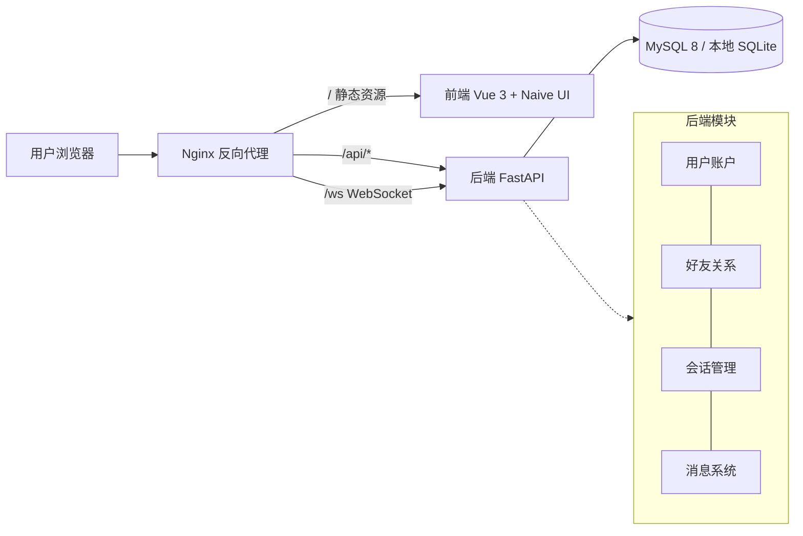

# 土豆聊天( Potato Messenger)

软工大作业 - 即时通讯系统:前后端分离 + RESTful API 契约 + WebSocket 实时推送,界面全中文。

> 本文是团队的交接文档:队友和新加入的 AI Agent 都应能在不问任何人的情况下,理解项目、搭好环境、找到契约、按规范提交代码。Agent 专用的硬性规则另见根目录 `AGENTS.md`。

## 1. 项目简介

实现一个类 iMessage 的即时通讯系统:用户/好友体系、单聊与群聊、未读与已读同步、消息撤回,要求实时(消息送达延迟 ≤ 200ms)、安全(加密存储、HTTPS、鉴权)且数据完整(离线补拉,消息不丢)。

对应课程评分:**系统基础 15 分**(联通/美观/安全/实时/完整性)、**功能 50 分**(用户与关系管理 / 会话通用功能 / 群聊)、**答辩 25 分**(必须能解释自己的代码,AI 辅助允许但需负责)、**文档 10 分**(需求分析、模块与 API 文档、数据库文档)。

## 2. 快速上手(本地开发,无 Docker)

环境要求:**Python 3.11+**、**Node.js 18+**(npm 随 Node 附带)。

```bash
bash scripts/setup.sh   # 一键初始化:依赖安装 + 生成 backend/.env(幂等,可重复执行)
bash scripts/dev.sh     # 一键同时启动前后端,Ctrl+C 双杀
```

然后打开 **http://localhost:5173**(前端)/ **http://localhost:8000/docs**(后端自动生成的 OpenAPI 文档)。注册两个账号互加好友即可体验单聊与实时推送。

<details>
<summary>手动分步(等价,便于理解每一步做了什么)</summary>

```bash
# 1. 后端(默认 SQLite,零配置)
cd backend
python3 -m venv .venv && source .venv/bin/activate
pip install -r requirements.txt
cp .env.example .env            # 已存在则不要覆盖
uvicorn app.main:app --reload --port 8000

# 2. 前端(另开终端;/api 与 /ws 已由 Vite 代理到 8000)
cd frontend
npm install                     # 有 lockfile 时 setup.sh 会用 npm ci
npm run dev
```
</details>

## 3. 架构总览



**消息可靠性模型**(需求文档核心,答辩必考):发送时同时写「会话链」(供历史拉取,新成员可见入群前消息)与「用户链」(写扩散,每成员一条含全局递增 `seq`);在线成员走 WebSocket 推送,推送携带 `prev_seq` 供客户端校验连续性;断线/离线走 REST `GET /api/v1/sync` 按 cursor 补拉 —— 双保险,消息不丢。

## 4. 目录结构

```
├── README.md               # 本文档:交接总览
├── AGENTS.md                # AI Agent 硬性规则(Cursor 等自动读取)
├── docs/                    # 评分要求的开发文档
│   ├── 01-技术选型分析.md     # 多栈对比与选型结论(为什么用 Vue3/FastAPI/Naive UI)
│   ├── 02-API约定.md        # RESTful API 契约 —— 前后端 Source of Truth
│   ├── 03-数据库设计.md      # 七张表结构、索引、写扩散模型
│   └── 04-部署方案.md       # 本地 / Docker / SECoder 三级部署
├── backend/                 # FastAPI 后端(独立运行 :8000)
│   ├── app/api/v1/          # 路由层:auth / users / friends / conversations / messages / sync / ws
│   ├── app/models/          # SQLAlchemy 表模型(与 docs/03 一一对应)
│   ├── app/schemas/         # Pydantic 请求/响应模型(与 docs/02 一一对应)
│   ├── app/services/        # 业务逻辑:消息分发(写扩散)、WS 连接管理
│   └── app/core/            # 配置、安全(bcrypt/JWT)、统一错误码
├── frontend/                # Vue 3 前端(独立运行 :5173)
│   ├── src/api/             # types.ts(契约 TS 版)/ http.ts / ws.ts / index.ts(端点门面)
│   ├── src/stores/          # Pinia:user(认证)/ chat(会话与消息)
│   ├── src/views/           # LoginView / ChatView
│   └── src/components/      # ConversationList / MessageList / MessageInput
├── nginx/                   # 反向代理:静态资源 + /api + /ws 转发
├── deploy/                  # K8s 清单(kustomization + manifests + patches)与镜像 Dockerfile
└── scripts/                 # setup.sh 初始化 / dev.sh 一键启动(均已实测)
```

## 5. API 契约工作流(核心,改接口前必读)

**契约唯一权威:[docs/02-API约定.md](docs/02-API约定.md)**。它规定统一响应包络 `{code, message, data}`、错误码表、JWT 鉴权、游标分页、24 个 REST 端点与 WebSocket 事件协议。

**改接口的三件套同步规则** —— 以下三处必须在**同一次提交**内一致变更,禁止只改一侧:

| 变更处 | 文件 |
|---|---|
| 1. 契约文档 | [docs/02-API约定.md](docs/02-API约定.md) |
| 2. 后端 Pydantic 模型 | [backend/app/schemas/](backend/app/schemas/) |
| 3. 前端 TS 类型 | [frontend/src/api/types.ts](frontend/src/api/types.ts) |

配套原则:
- **前端驱动 API 设计**:接口以满足前端页面需求为目标,不让前端绕着接口凑数据(课程讲义要求);
- 后端改完启动 `uvicorn`,打开 `/docs` 核对自动生成的 OpenAPI 与契约一致;
- 已定字段名(`snake_case`)不重命名,只做增量扩展;
- WebSocket 事件(`message.new`/`read.sync`/`message.recall`/`conversation.update`/`friend.request`)的变更同样受此规则约束。

## 6. 环境与配置管理

| 场景 | 数据库 | 说明 |
|---|---|---|
| 本地开发(默认) | SQLite `backend/potato.db` | 零配置,首次启动自动建表,已被 gitignore |
| 生产 / Compose / SECoder | MySQL 8 | 通过环境变量切换 |

**配置链路**:`scripts/setup.sh` 从 [backend/.env.example](backend/.env.example) 生成 `backend/.env`(已有则不覆盖);生产环境不使用 `.env`,改由 K8s ConfigMap/Secret 注入(见 docs/04)。

**Gitignore 管理(为什么有的文件"消失"了)**:

- 永不入库:`.env`(含密钥)、`.venv/`、`node_modules/`、`*.db`、`dist/`、各类缓存与日志 —— 规则见 [.gitignore](.gitignore);
- 必须入库:`.env.example`(模板)、`package-lock.json`(保证 `npm ci` 依赖树可复现)、`requirements.txt`;
- 常见误区:本地"怎么文件不见了"先查 `git check-ignore -v <路径>` 再来问。

## 7. Git 协作规范

- **分支模型**:`main` 为受保护分支(保持随时可部署);功能分支 `feat/<名>`、修复分支 `fix/<名>`、文档分支 `docs/<名>`,完成后发 PR 合并;
- **提交信息**:Conventional Commits,`类型: 中文简述`,如 `feat: 好友申请列表页`、`fix: WS 重连后 prev_seq 校验误报`、`docs: 补充数据库设计`;
- **提交粒度**:一个提交做一件事;改接口的"三件套"(见第 5 节)不得拆到多个提交;
- **提交前自查**:前端 `npx vue-tsc --noEmit` 通过;后端能启动且 `curl http://127.0.0.1:8000/api/v1/health` 返回 `code:0`;无 `.env` / 密钥 / 本地数据库混入(`git status` 检查);
- **PR 描述**:改了什么、为什么、如何验证、关联文档章节;涉及接口变更必须 @全体 前后端同学。

## 8. 命令速查表

| 用途 | 命令 |
|---|---|
| 一键初始化(幂等) | `bash scripts/setup.sh` |
| 一键启动前后端 | `bash scripts/dev.sh` |
| 前端类型检查 | `cd frontend && npx vue-tsc --noEmit` |
| 前端生产构建 | `cd frontend && npm run build` |
| 后端健康检查 | `curl http://127.0.0.1:8000/api/v1/health` |
| 后端 API 文档 | 浏览器打开 `http://localhost:8000/docs` |
| Docker 全栈 | `docker compose -f deploy/docker-compose.yml up --build` |
| 端口被占用时 | `lsof -ti :8000 \| xargs kill`(5173 同理) |
| 重置本地数据库 | `rm backend/potato.db`(重启后端自动重建) |

## 9. 故障排查

| 症状 | 原因与处理 |
|---|---|
| `uvicorn` 起不来,端口被占 | 上一个进程未退干净:`lsof -ti :8000 \| xargs kill` 后重启 |
| macOS 报 Python 版本过低 | 系统自带 `/usr/bin/python3` 是 3.9,安装 python.org 的 3.11+ 并确保 `python3` 指向它 |
| 前端请求 404 / 跨域 | 确认后端在 8000 运行,Vite 代理才生效;生产环境检查 nginx `/api`、`/ws` 转发配置 |
| WS 连不上(403/断开) | token 失效会返回 4401;检查 `backend/.env` 的 `JWT_SECRET` 是否被改动过(改过则旧 token 全部失效,重新登录) |
| 依赖异常 | 有 `package-lock.json` 一律用 `npm ci`(setup.sh 已内置),不要随手 `npm install` 更新依赖树 |
| 想用 MySQL 但没起 | 保持默认 SQLite 即可开发;切换方式见 `backend/.env.example` 的 `DATABASE_URL` 注释 |

## 10. 文档索引(改什么读什么)

| 你要做什么 | 先读 |
|---|---|
| 理解为什么选这套技术栈 / 换库 | [docs/01-技术选型分析.md](docs/01-技术选型分析.md) |
| 调用或修改接口、加新端点 | [docs/02-API约定.md](docs/02-API约定.md) |
| 改表结构、加字段、写迁移 | [docs/03-数据库设计.md](docs/03-数据库设计.md) |
| 部署、CI/CD、SECoder | [docs/04-部署方案.md](docs/04-部署方案.md) |
| 前端界面规范 / 主题令牌 | [docs/05-前端界面规范.md](docs/05-前端界面规范.md) |
| 前端模块验收与同步说明 | [docs/06-前端模块说明.md](docs/06-前端模块说明.md) |
| 是 AI Agent,要动这个仓库 | [AGENTS.md](AGENTS.md) |

## 11. 部署

- **Docker 单机全栈**:`docker compose -f deploy/docker-compose.yml up --build` → http://localhost:8080(MySQL + 后端 + 前端 + Nginx);
- **SECoder(K8s)**:清单在 `deploy/`,由 Kustomize 渲染(`kubectl kustomize deploy` 可本地预览;应用为 `kubectl apply -k deploy`),完整流程与所需 CI 变量见 [docs/04-部署方案.md](docs/04-部署方案.md);
- 镜像 tag 由 CI 注入(`${CI_COMMIT_SHORT_SHA}`);`JWT_SECRET` 与数据库密码**只走 Secret**,不落仓库。

## 12. 安全红线(课程硬性要求,答辩必查)

- **密码**:bcrypt 加盐哈希,任何接口不返回 `password` 字段([backend/app/core/security.py](backend/app/core/security.py));
- **传输**:生产强制 HTTPS(SECoder Ingress TLS),禁止明文 HTTP;
- **CORS**:白名单制(`CORS_ORIGINS`),禁止 `*`;
- **前端不可信原则**:后端对一切输入做 Pydantic 校验 + 权限判断,不信任何前端校验;
- **密钥**:`JWT_SECRET` 生产必须为 32 字节以上随机值,经 Secret 注入;`.env` 永不入库;
- **注入/XSS**:全程 ORM 参数化查询;消息按纯文本渲染(富文本上线前需加白名单过滤);
- 详细清单见 [docs/04-部署方案.md](docs/04-部署方案.md) 第 6 节。

## 13. 技术栈

| 层 | 选型 |
|---|---|
| 前端 | Vue 3 + TypeScript + Vite + Pinia + Naive UI |
| 后端 | Python FastAPI + Pydantic v2 |
| ORM / 数据库 | SQLAlchemy 2.0 / MySQL 8(生产)、SQLite(本地默认) |
| 鉴权 | JWT + bcrypt 加盐哈希 |
| 实时 | WebSocket 推送 + REST cursor 补拉 |
| 代理 / 部署 | Nginx + Docker + SECoder(Kubernetes) |

选型理由与替代方案对比见 [docs/01-技术选型分析.md](docs/01-技术选型分析.md)。

## 14. 后续扩展路线(骨架 → 完整功能)

- [ ] 好友管理页(搜索用户、申请列表、备注/分组)
- [ ] 群聊创建/管理 UI(成员列表、公告、管理员设置)
- [ ] 消息回复(点击回复跳转原消息)、右键菜单(撤回/删除)
- [ ] 头像上传(对象存储)、图片消息
- [ ] 群邀请审批流(后端已预留权限模型)
- [ ] Alembic 数据库迁移;JWT 黑名单(登出失效)
- [ ] WS 多副本:Redis PubSub 替代进程内连接管理