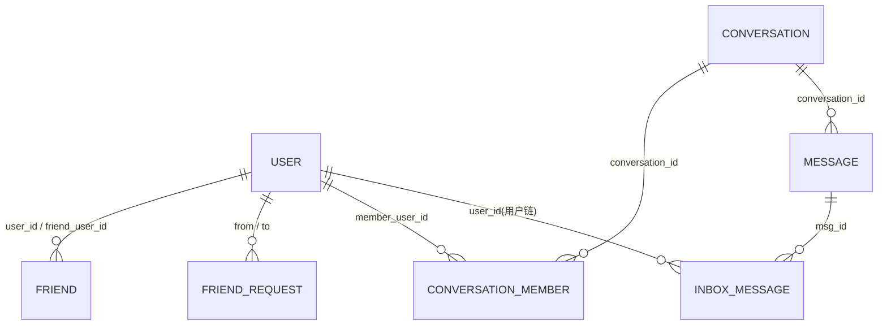

# 03 数据库设计

> 对应需求文档"服务端存储"章节的六张核心表,并补充好友申请表(功能需求所需)。
> ORM 模型位于 `backend/app/models/`,以 SQLAlchemy 2.0 声明式语法实现,本表结构与代码一一对应。

## 1. ER 关系概览

## 2. 表结构

### 2.1 `user` 用户表

| 字段 | 类型 | 约束 | 说明 |
|---|---|---|---|
| user_id | BIGINT | PK, 自增 | 用户唯一标识 |
| name | VARCHAR(32) | UNIQUE, NOT NULL | 用户名(2–32 字符,允许中文) |
| password | VARCHAR(72) | NOT NULL | **bcrypt 加盐哈希**(不存明文) |
| avatar | VARCHAR(255) | NULL | 头像 URL(骨架阶段可空) |
| email | VARCHAR(128) | NULL | 邮箱 |
| phone | VARCHAR(32) | NULL | 手机号 |
| register_time | INT | NOT NULL | 注册时间戳 |
| login_time | INT | NULL | 最近登录时间戳 |

### 2.2 `friend` 好友关系表(双向两行存储)

| 字段 | 类型 | 约束 | 说明 |
|---|---|---|---|
| user_id | BIGINT | PK(联合), FK→user | 关系拥有方 |
| friend_user_id | BIGINT | PK(联合), FK→user | 好友方 |
| remark | VARCHAR(64) | NULL | 好友备注 |
| group_name | VARCHAR(32) | NULL | 自定义分组 |
| update_time | INT | NOT NULL | 关系更新时间 |

> 设计说明:A、B 成为好友时插入 `(A,B)` 与 `(B,A)` 两行,使"拉好友列表"始终是单表单条件查询,无需 UNION。

### 2.3 `friend_request` 好友申请表(扩展,支撑好友功能)

| 字段 | 类型 | 约束 | 说明 |
|---|---|---|---|
| request_id | BIGINT | PK, 自增 | 申请 ID |
| from_user_id | BIGINT | FK→user | 申请人 |
| to_user_id | BIGINT | FK→user | 被申请人 |
| status | VARCHAR(16) | NOT NULL | `pending` / `accepted` / `rejected` |
| create_time | INT | NOT NULL | 申请时间 |
| update_time | INT | NOT NULL | 处理时间 |

### 2.4 `conversation` 会话表(单聊/群聊统一)

| 字段 | 类型 | 约束 | 说明 |
|---|---|---|---|
| conversation_id | BIGINT | PK, 自增 | 会话 ID |
| name | VARCHAR(64) | NULL | 会话名(群聊显示群名;单聊为空,前端显示对方昵称) |
| type | VARCHAR(16) | NOT NULL | `private` / `group` |
| avatar | VARCHAR(255) | NULL | 群头像 |
| owner_id | BIGINT | FK→user | 群主(单聊为空) |
| announcement | TEXT | NULL | 群公告 |
| create_time | INT | NOT NULL | 创建时间 |
| update_time | INT | NOT NULL | 最近消息/信息变更时间(用于会话列表排序) |

### 2.5 `conversation_member` 会话成员表

| 字段 | 类型 | 约束 | 说明 |
|---|---|---|---|
| conversation_id | BIGINT | PK(联合), FK→conversation | 会话 |
| member_user_id | BIGINT | PK(联合), FK→user | 成员 |
| role | VARCHAR(16) | NOT NULL | `owner` / `admin` / `member` |
| join_time | INT | NOT NULL | 入群时间 |
| update_time | INT | NOT NULL | 记录更新时间 |
| read_index | BIGINT | NOT NULL, DEFAULT 0 | **已读位置**:该成员用户链上最后已读消息的 seq(未读数 = 本会话最新 seq − read_index) |
| pinned | TINYINT | NOT NULL, DEFAULT 0 | 是否置顶 |
| muted | TINYINT | NOT NULL, DEFAULT 0 | 是否免打扰 |

### 2.6 `message` 消息内容 + 会话链(合并为一张表)

| 字段 | 类型 | 约束 | 说明 |
|---|---|---|---|
| msg_id | BIGINT | PK, 自增 | 消息唯一 ID(全局) |
| conversation_id | BIGINT | INDEX, FK→conversation | 所属会话(会话链) |
| sender_id | BIGINT | INDEX, FK→user | 发送者 |
| body | TEXT | NOT NULL | 消息内容(骨架阶段为纯文本) |
| reply_to | BIGINT | NULL | 被回复消息的 msg_id |
| create_time | INT | INDEX, NOT NULL | 发送时间戳 |

> 会话链拉取:`WHERE conversation_id = ? AND msg_id < cursor ORDER BY msg_id DESC LIMIT n`;新成员入群凭 conversation_id 即可拉取历史(需求:入群可见入群前消息)。

### 2.7 `inbox_message` 用户链(写扩散)

| 字段 | 类型 | 约束 | 说明 |
|---|---|---|---|
| id | BIGINT | PK, 自增 | 用户链序号 **seq(单用户内递增,全局不要求连续)** |
| user_id | BIGINT | PK(联合: user_id+id), FK→user | 收件人 |
| conversation_id | BIGINT | INDEX, FK→conversation | 消息所属会话(前端按会话归组) |
| msg_id | BIGINT | FK→message | 指向消息本体 |
| kind | VARCHAR(16) | NOT NULL | `message` / `recall` / `read` / `delete`(命令消息) |
| payload | JSON | NULL | 命令消息附加数据(如 read_index) |
| create_time | INT | NOT NULL | 写入时间 |

> - **写扩散**:发送一条群消息时,为每个成员插入一行 inbox_message;
> - **兜底拉取** `/sync`:`WHERE user_id = ? AND id > cursor ORDER BY id LIMIT n`,以 `id`(即 seq)做 cursor;
> - **推送一致性校验**:推送携带 `prev_seq`,与客户端本地 cursor 比对,不一致即触发 `/sync` 补拉;
> - **离线消息**:用户不在线时不推送,登录后用 `/sync?cursor=本地最后seq` 补拉,天然满足"离线消息"需求。
> - **本地删除的表示(投递墓碑)**:用户"只删自己这边"时**不物理删行**,而是把该行改写成
>   `kind="delete"`,并写 `payload = {"msg_id": ..., "conversation_id": ...}`。理由:
>   - 会话历史(查 `message` 表)与增量同步(查 `inbox_message` 表)若分别用不同口径,会出现
>     "历史里看不到、`/sync` 又拉回来"或反过来的矛盾;墓碑让两条路径按同一规则过滤;
>   - `/sync` 从此能明确表达"这条被我删了",离线设备补拉后也能清掉本地缓存,不必另外加协议机制;
>   - **不需要新增列、不需要迁移**:`kind` 的枚举本就包含 `delete`,而 `create_all` 不会给既有表加列,
>     生产库又是挂在持久卷上的 SQLite(有真实数据),因此这里刻意避免 DDL;
>   - 改写沿用原行的 `id`(seq),不会让 cursor 产生空洞;若该消息原本没有我的投递行
>     (例如入群前的历史消息),则补写一条墓碑行,保证两处口径一致。
> - **已读位置的单调与上限**:`read_index` 只允许**向前**推进,且不得超过该用户用户链的最新 seq
>   (越界返回 `400/1001`)。若本地删除的目标排在已读位置之后,`read_index` 会被回压到被删消息之前
>   —— 否则单调约束会把客户端随后的合法上报判成"回退"。被删消息本身不计入未读数,故回压不会虚增未读。
> - **未读数口径**:`seq > read_index`、`kind="message"`、且**未被墓碑标记**的条数。
>   会话历史、`/sync`、未读数三处必须使用同一套过滤规则,否则会出现"看不到却还算未读"的矛盾。

## 3. 关键索引

| 表 | 索引 | 支撑查询 |
|---|---|---|
| friend | `(user_id)` | 好友列表 |
| conversation_member | `(member_user_id)` | 我的会话列表 |
| message | `(conversation_id, msg_id DESC)` | 会话历史翻页 |
| inbox_message | `(user_id, id DESC)` | /sync 兜底拉取 |
| user | `name UNIQUE` | 注册查重、搜索 `LIKE 'x%'`(前缀走索引) |

## 4. 数据完整性

- 好友删除、用户注销:事务内级联删除 friend / conversation_member / inbox_message 相关行(注销账号需"完全清除消息与好友"——需求文档硬性要求);
- 撤回不物理删除 `message` 行,仅置 `body` 为撤回占位并投递命令消息,保证多端一致与历史完整;
- 所有外键加 `ON DELETE CASCADE`(注销/解散场景);
- 建表入口:`backend/app/models/__init__.py` 的 `Base.metadata.create_all`,生产建议引入 Alembic 迁移(扩展项)。