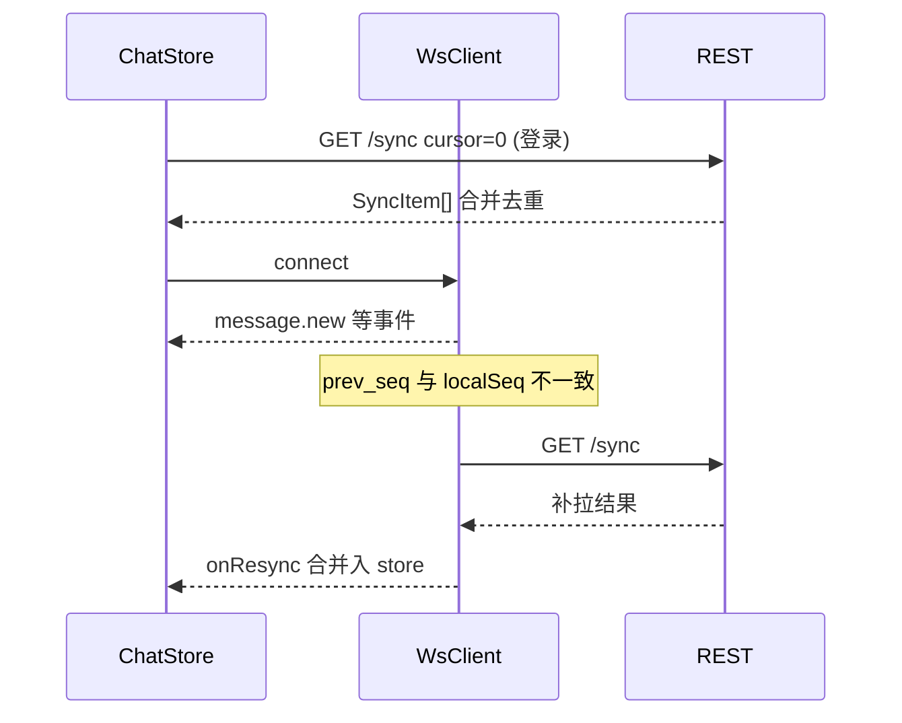

# 06 前端模块说明

> Role A 交付:页面验收步骤、消息同步状态、错误处理与联调清单。  
> 契约权威:[02-API约定.md](02-API约定.md);界面规范:[05-前端界面规范.md](05-前端界面规范.md)。

## 1. 模块结构

| 路径 | 职责 |
|---|---|
| `src/api/` | `types.ts` 契约类型; `index.ts` REST 门面; `ws.ts` 推送与补拉; `http.ts` 包络/鉴权 |
| `src/stores/user.ts` | 登录态、资料、注销 |
| `src/stores/friends.ts` | 好友列表、申请、搜索 |
| `src/stores/chat.ts` | 会话、消息、已读/置顶/免打扰、群管理、同步合并 |
| `src/stores/theme.ts` | 浅色/深色 |
| `src/views/` | Login / Chat / Friends / Profile |
| `src/components/` | MainLayout、会话列表、消息区、输入、建群、群管理 |

## 2. 消息同步规则(与 D 对齐)



1. **去重**:按 `msg_id` 合并;同 ID 后写覆盖。  
2. **排序**:会话内按 `msg_id` 升序(与时间顺序一致)。  
3. **已读**:`read_index` 必须用历史消息的 `seq`,禁止用 `msg_id`。  
4. **撤回**:本地将 `body` 改为 `[消息已撤回]`。  
5. **本地删除**:`DELETE .../messages/{id}` 后从列表移除;多端靠 `message.delete` / sync `kind=delete`。  
6. **断线**:`onclose` 指数退避重连;重连成功后若 `localSeq>0` 自动 `/sync`。  
7. **发送失败**:输入区捕获错误,展示服务端 `message`,草稿保留。

## 3. 页面验收步骤

### 账号

1. 注册合法账号 → 自动登录进入会话页。  
2. 非法密码(无数字) → 前端校验提示。  
3. 错误密码登录 → 展示后端错误文案。  
4. 资料页改昵称/邮箱 → 刷新后仍在。  
5. 改密后用新密码可登录。  
6. 注销 → 回登录页,旧 token 失效。

### 好友(联调 C)

1. 搜索用户 → 发申请 → 对方同意 → 双方列表出现。  
2. 拒绝/删除后列表与后端一致。  
3. 「发消息」→ 进入私聊且会话列表出现。

### 群(联调 C)

1. 选好友建群 → 会话出现。  
2. 群管理改名/公告(群主或管理员)。  
3. 邀请/移除成员,角色标签正确。  
4. 退出群 → 会话列表更新。  
5. 群主转让:契约未定时页面提示待扩展。

### 聊天与同步(联调 D)

1. 双方互发 → 实时到达,本人气泡在右。  
2. 右键回复/撤回(2 分钟内)/删除。  
3. 「加载更早消息」分页无重复。  
4. 定位原消息:未加载时自动翻页;不可见时 toast。  
5. 断网再恢复 → 无漏消息、无重复气泡。  
6. 置顶/免打扰 → 刷新后仍有效;置顶排在前。

### 主题

1. 顶栏切换浅色/深色 → 气泡与侧栏跟令牌变色。  
2. 刷新页面主题保持。

## 4. 错误映射

| 场景 | 行为 |
|---|---|
| `ApiError` | `useMessage().error(e.message)` |
| 网络失败 | 「网络异常,请稍后重试」 |
| HTTP 1002 | `http.ts` 清 token 并跳转 `/login` |

## 5. 联调清单

| 伙伴 | 前端负责 | 依赖对方 |
|---|---|---|
| B | 登录/资料/改密/注销/置顶免打扰 UI | 鉴权与 `PATCH/DELETE /users/me`、`PATCH .../me` |
| C | 好友页、建群、群管理抽屉 | 好友/群成员/公告接口与权限码 |
| D | WS 消费、`/sync` 合并、历史分页、回复定位、已读 seq | 推送事件与用户链连续性 |

## 6. 构建

```bash
cd frontend && npm ci && npx vue-tsc --noEmit && npm run build
```

CI 已有 `frontend-typecheck`;镜像构建由 B 的流水线 `build-frontend` 负责。
